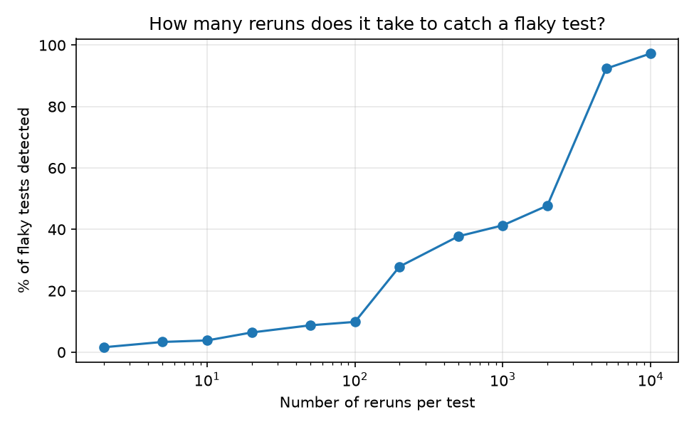
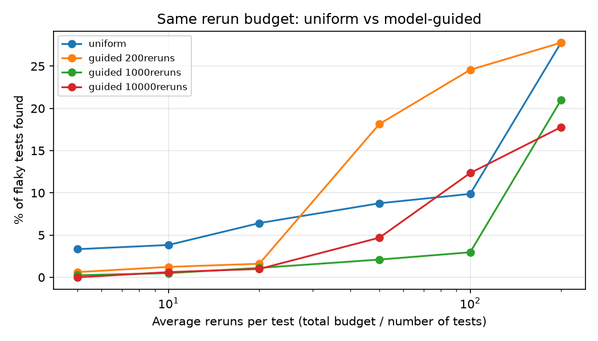

# Flaky Test Prediction

By Jannatul Ferdus Mim

I work in test automation, and flaky tests are a headache. A flaky test passes on one run and fails on the next, even though the code did not change. When a build goes red, nobody knows if it is a real bug or just noise.

This repository is my attempt to look at that problem in two ways: by counting what happened in past runs, and by using machine learning to guess which tests are risky.

## What is here

| Part | What it does | Where |
| --- | --- | --- |
| Flaky Test Finder | Reads test reports from many runs, finds the flaky tests, and tells you how many reruns you need before you can trust the answer. No machine learning. | [`flaky_test_finder/`](flaky_test_finder/) (it has its own README) |
| Flaky Classifier | Predicts which tests are flaky from their features, then checks if that can save rerun cost. | `flaky_classifier.py` |

The two parts are meant to work together. The Finder counts what already happened. The Classifier tries to point at risky tests before I spend a lot of reruns.

## Flaky Classifier

### The data

I use the public FlakeFlagger dataset (Alshammari et al., ICSE 2021). It has two files:

- `processed_data.csv` has the features of each test (test smells, test length, coverage, change history and more) and a flaky label.
- `test_results.csv` has the result of rerunning each test 10,000 times.

| | Number |
| --- | --- |
| Tests in the rerun file | 22,237 |
| Flaky tests | 811 (3.65%) |
| Projects | 24 |
| Tests matched between the two files | 22,179 of 22,236 |

Only 3.65% of the tests are flaky. A model that always says "not flaky" is already right about 96% of the time. So I do not use accuracy. I look at PR-AUC, precision and recall instead.

### What the code does

1. It joins the feature file with the rerun file.
2. It measures how many reruns it takes to see a flaky test both pass and fail.
3. It trains four models: a "majority class" guess, logistic regression, random forest and gradient boosting.
4. It tests them with project-grouped 5-fold cross-validation. This means tests from one project never appear in both training and testing. I chose this because it asks a harder question: does the model work on a project it has never seen?
5. It compares two ways of spending the same rerun budget.

### What I found

**Flaky tests are hard to catch by rerunning.** In this dataset, most flaky tests fail very rarely, so a small number of reruns misses almost all of them.

| Reruns per test | Flaky tests found |
| --- | --- |
| 10 | 3.8% |
| 100 | 9.9% |
| 1,000 | 41.3% |
| 5,000 | 92.4% |
| 10,000 | 97.3% |



**The models beat guessing, but they are not strong.** I want to say this clearly.

| Model | PR-AUC | ROC-AUC | Precision (tuned) | Recall (tuned) | F1 (tuned) |
| --- | --- | --- | --- | --- | --- |
| Majority class | 0.036 | 0.500 | 0.036 | 1.000 | 0.070 |
| Logistic regression | 0.060 | 0.583 | 0.077 | 0.429 | 0.130 |
| Random forest | 0.145 | 0.751 | 0.320 | 0.185 | 0.234 |
| Gradient boosting | 0.111 | 0.702 | 0.119 | 0.224 | 0.156 |

Random forest did best. Its PR-AUC is about four times the guessing baseline. But when it says a test is flaky, it is right only about 1 time in 3, and it finds only about 1 in 5 of the real flaky tests. Predicting flakiness for a new project is hard.

**Guided reruns can help when the budget is medium.** Here I ask: with the same total number of reruns, is it better to rerun every test the same number of times, or to rerun only the top-scored tests (from the random forest) 200 times each?

| Average reruns per test | Uniform finds | Guided finds |
| --- | --- | --- |
| 5 | 3.3% | 0.6% |
| 10 | 3.8% | 1.2% |
| 20 | 6.4% | 1.6% |
| 50 | 8.8% | 18.1% |
| 100 | 9.9% | 24.6% |
| 200 | 27.8% | 27.8% |

With a small budget (5 to 20 reruns per test), uniform is better. With a medium budget (50 to 100), guided finds two to three times more flaky tests. At 200, guided picks every test, so the two are the same. I also tried 1,000 and 10,000 reruns for the guided tests, and they never beat uniform.



### Limits

- I used one dataset and one random seed (42).
- I chose the threshold for the "tuned" numbers on the same predictions that I score, so those numbers are a little too optimistic.
- I also picked the best model (random forest) from the same scores.
- 57 tests could not be matched between the two files, so they are not in the budget test.
- The model only uses test features. It does not tell me why a test is flaky.

## How to run

You need Python 3.8 or newer and a few packages:

```
pip install pandas numpy scikit-learn matplotlib
python flaky_classifier.py --features processed_data.csv --reruns test_results.csv --out results
```

The results go to the `results/` folder: `metrics.csv`, `budget.csv`, `detection_curve.png`, `budget_comparison.png` and `summary.txt`.

## What I want to do next

- Use the Finder's labels as training data for the Classifier.
- Look at the "healthy" tests that the model scores as risky. They may be rare flaky tests that rerunning cannot see.
- Try both tools on public CI reports from open-source projects.

## Credit

This work is based on FlakeFlagger and uses its public dataset. I am not claiming a new method.

A. Alshammari, C. Morris, M. Hilton and J. Bell, "FlakeFlagger: Predicting Flakiness Without Rerunning Tests", International Conference on Software Engineering (ICSE), 2021. Dataset: <https://zenodo.org/record/4450723>
